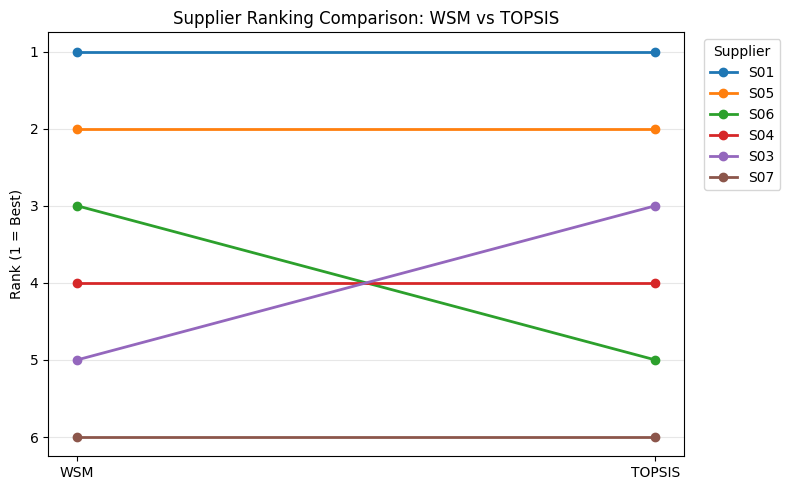

# Supplier-Selection-for-Arabica-Green-Coffee-Beans
Independent project on supplier selection for Vietnamese Arabica green coffee using WSM, TOPSIS, and sensitivity analysis.

## 1. Project Overview

The project examines supplier selection for a Vietnamese exporting company purchasing fully washed Arabica green coffee from domestic suppliers. The analysis compares eight hypothetical suppliers (S01-S08) using simulated EXW prices for a reference quantity of 20 metric tonnes (MT).

The objective is to identify a preferred supplier based on main criteria such as cost, quality, delivery, and traceability, and to examine how changes in procurement priorities affect the rankings.

The project uses Excel for data preparation and Python for supplier evaluation. All supplier data are simulated and do not represent actual businesses.

## 2. Dataset

The dataset contains eight hypothetical suppliers, with information on EXW prices, estimated logistics costs, green coffee quality, delivery performance, certification status, and traceability.

Suppliers are first screened against three buyer-defined requirements:

- Moisture content between 9% and 13%.
- No more than 23 full defects per 300g.
- Compliance with the assumed certification requirement.

Six suppliers meet these requirements and proceed to the ranking stage.

Four criteria are used in the quantitative evaluation:

| Criterion | Measurement | Preference |
|---|---|---|
| Delivered Cost | EXW price + estimated logistics cost (USD/MT) | Lower |
| Product Quality | Full defects per 300g | Lower |
| On-time Delivery | On-time delivery rate (%) | Higher |
| Traceability | Score (0-100) | Higher |

The screening requirements, evaluation criteria, and weights are defined for this case study and would need to be reviewed against the company's actual procurement requirements and priorities before practical use.

## 3. Methodology

The analysis follows three steps.

**Supplier screening.** Suppliers that fail any mandatory requirement are excluded from the ranking.

**Supplier ranking.** Eligible suppliers are evaluated using two multi-criteria decision-making methods:

- WSM combines normalized criterion values using assigned weights.
- TOPSIS ranks suppliers according to their relative distances from the positive and negative ideal solutions.

**Sensitivity analysis.** Both methods are applied under three weighting scenarios to examine how supplier rankings respond to changes in procurement priorities.

| Criterion | Base | Cost-focused | Traceability-focused |
|---|---:|---:|---:|
| Delivered Cost | 40% | 70% | 40% |
| Product Quality | 20% | 15% | 20% |
| On-time Delivery | 20% | 10% | 15% |
| Traceability | 20% | 5% | 25% |

The same supplier data and screening requirements are used across all three scenarios.

## 4. Key Results

S01 ranks first and S05 second under both WSM and TOPSIS across all three weighting scenarios.

Under the Base scenario, the two methods agree on the top two suppliers but produce different rankings for some others.

WSM rankings remain unchanged across the three scenarios. TOPSIS shows some movement among the middle-ranked suppliers, particularly S03, S04, and S06.

The results support selecting S01 for further supplier evaluation, with S05 as an alternative. This recommendation applies only to the simulated data and assumptions used in the project.

### Base Scenario Ranking Comparison

For the complete results and discussion, see the [Analysis Report](https://github.com/NguyenThiThuyDung03/Supplier-Selection-for-Arabica-Green-Coffee-Beans/blob/main/Arabica_Supplier_Selection_Report_Final.pdf).

## 5. Repository Structure

| Folder | Contents |
|---|---|
| `data/` | [Excel Input dataset](https://github.com/NguyenThiThuyDung03/Supplier-Selection-for-Arabica-Green-Coffee-Beans/blob/main/Arabica_Supplier_Selection_Inputdata.xlsx) with supplier information, parameters, and supporting assumptions |
| `notebooks/` | [Python analysis notebook](https://github.com/NguyenThiThuyDung03/Supplier-Selection-for-Arabica-Green-Coffee-Beans/blob/main/Arabica_Supplier_Selection_PythonAnalysis.ipynb) |
| `results/` | [Excel results workbook](https://github.com/NguyenThiThuyDung03/Supplier-Selection-for-Arabica-Green-Coffee-Beans/blob/main/Arabica_Supplier_Selection_Results.xlsx) containing screening, rankings, and sensitivity results |
| `figures/` | [WSM and TOPSIS ranking comparison figure](https://github.com/NguyenThiThuyDung03/Supplier-Selection-for-Arabica-Green-Coffee-Beans/blob/main/Supplier%20Ranking%20Comparison%20WSM%20vs%20TOPSIS.png) |
| `reports/` | [Analysis Report](https://github.com/NguyenThiThuyDung03/Supplier-Selection-for-Arabica-Green-Coffee-Beans/blob/main/Arabica_Supplier_Selection_Report_Final.pdf) |

## 6. How to Reproduce the Analysis

The analysis was developed in Google Colab using Python.

1. Download the input Excel workbook from the `Arabica_Supplier_Selection_Inputdata` folder.
2. Open the notebook in the `Arabica_Supplier_Selection_PythonAnalysis` folder using Google Colab.
3. Upload the input workbook to the Colab session.
4. Run the notebook cells to reproduce the screening, WSM, and TOPSIS rankings, sensitivity analysis, and exported results.

The full reference list, evaluation assumptions, and methodological details are provided in the [Analysis Report](reports/Supplier_Selection_Report.pdf).
